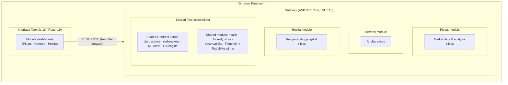

# 5. Building Block View

## 5.1 Whitebox Overall System

Ouranos Pantheon is a **modular monolith**: one .NET host (the *Gateway*) composes all
modules into a single deployable, plus a separate Next.js *Interface* application.



The diagram shows containment only; each module's feature slices are enumerated in its own
documentation (see [5.3](#53-blackboxes-modules)).

### Composition mechanics

The Gateway is a thin composition root. `HostingExtensions.cs`
(`src/apps/gateway/.../Startup/`) declares the module array and delegates to two
extension methods in the Shared module (`CoreExtensions.cs`):

```csharp
private static readonly IReadOnlyList<IPantheonModule> Modules =
[
    new SharedModule(),
    new HermesModule(),
    new PlutusModule(),
    new HestiaModule(),
];
```

- `AddOuranosCore(builder.Configuration, Modules)`: configures Serilog, REST conventions,
  Flagsmith, observability, Wolverine (with handler discovery across **all** module
  assemblies and each module's `ConfigureWolverine` hook), TickerQ, caching, and shared
  health checks; then calls `Build` on every module.
- `UseOuranosCore(app, Modules)`: migrates the TickerQ store, maps every module's
  endpoints (`MapEndpoints`), and runs each module's async configuration (`Configure`).

Adding a domain means adding a module and one line to this array; nothing else in the
gateway changes. All data-loader workers and scheduled jobs run as in-process hosted
services inside the gateway process; the two images (gateway, interface) are the whole
system.

### Module invariants

1. **No module references another module's assembly.** Each module `.csproj` references
   only `Ouranos.Pantheon.Modules.Shared.Contract`. Only the Gateway references all
   modules.
2. **One assembly per module.** Plutus is a single project; boundaries are enforced by
   folder layout and review rather than by project splitting.
3. **The kernel contains no domain logic.** `Shared.Contract` holds only abstractions and
   generic infrastructure (see [Section 8](08-crosscutting-concepts.md)).
4. **In-process handler dispatch.** All endpoints go through Wolverine's `IMessageBus`;
   no module ever calls another module's handler type directly.

### How building blocks relate

Slices never call each other's handlers, so the static dependency graph between feature
folders is nearly empty by design. Within a module, all coupling is data coupling: async
handoffs travel over RabbitMQ (see [Section 8.4](08-crosscutting-concepts.md#84-messaging-wolverine--rabbitmq)),
and everything else is one slice reading what another has written to the module's own
Postgres schema. Across modules the only shared
things are the kernel and the gateway composition. The meaningful interactions are
therefore dynamic; see [Section 6](06-runtime-view.md) and each module's runtime view.

## 5.2 Blackbox: Interface (`src/apps/interface`)

Next.js App Router dashboard. Talks to the Gateway exclusively through a typed
`api-client` (`src/lib/api-client.ts`) pointed at `NEXT_PUBLIC_API_BASE`. State is held in
Zustand stores (`src/stores/`, e.g. `plutus-store.ts`). Pages compose feature components
from per-route component folders (`_components/`).

## 5.3 Blackboxes: Modules

Each module is a blackbox at this level. Its whitebox (level 2), runtime scenarios,
module-specific concepts, debt, glossary and module-scoped decisions are owned by the
module and live next to its code in `src/modules/<module>/docs/`. This table changes only
when a module is added, renamed or removed.

| Module | Responsibility | Persistence | Documentation |
|--------|----------------|-------------|---------------|
| **Plutus** | Market data ingestion, signals, forecasts, strategies and backtests for FFXIV, OSRS and US equities | EF Core + TimescaleDB, schema `plutus` | [Plutus docs](../../src/modules/plutus/docs/README.md) |
| **Hermes** | Chat over locally hosted LLMs: conversations, personas, traits, models | EF Core, schema `hermes` | [Hermes docs](../../src/modules/hermes/docs/README.md) |
| **Hestia** | Event-sourced recipes, recipe import, shopping list | Marten (events + documents) | [Hestia docs](../../src/modules/hestia/docs/README.md) |
| **Shared** | The shared kernel (`Shared.Contract`) and the Shared module that composes the host | EF Core, Shared and TickerQ stores | [Shared docs](../../src/modules/shared/docs/README.md) |

## 5.4 Tests

`tests/` mirrors `src/` (`tests/modules/{plutus,hermes,hestia,shared}`,
`tests/apps/`, `tests/Ouranos.Pantheon.Tests.Utils/`). Stack: xUnit + AutoFixture +
NSubstitute + Shouldly, EF Core InMemory for data tests.
