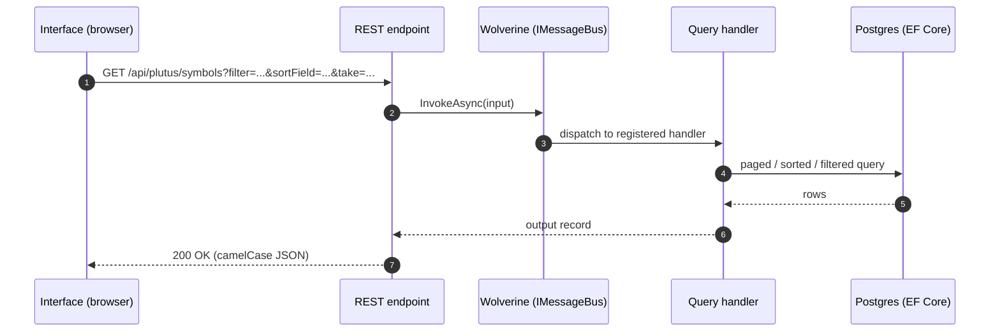
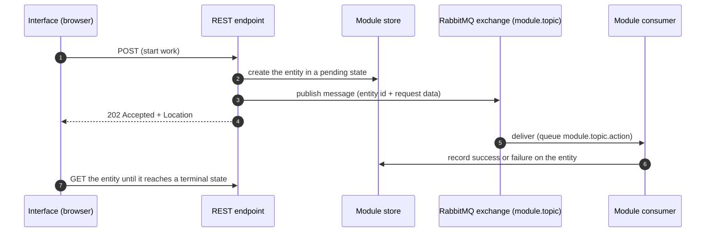
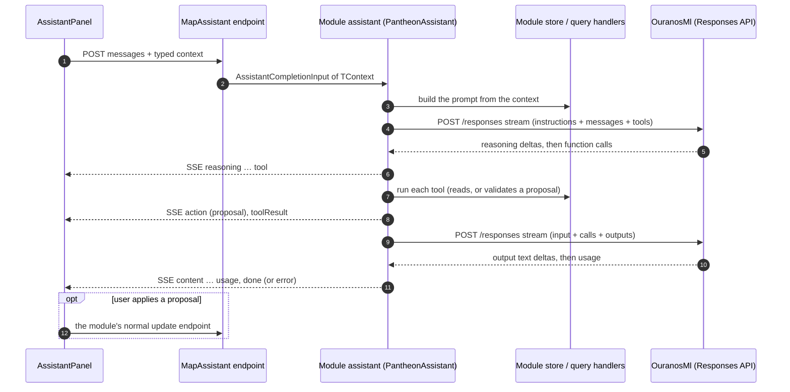

# 6. Runtime View

This section traces the platform-level scenarios: the patterns every module's flows are
built from. They are driven by the building blocks of
[Section 5](05-building-block-view.md) and the conventions of
[Section 8](08-crosscutting-concepts.md). Module-specific scenarios (trade ingestion,
backtests, recipe import, chat, and each module's assistants) are documented by the owning
module; see the module table in [Section 5.3](05-building-block-view.md#53-blackboxes-modules).

## 6.1 Scheduled Jobs

Recurring work is coordinated by TickerQ jobs, all in-process, with an EF Core-backed store
and a dashboard at `/tickerq/dashboard` that lists every job by its TickerQ function name.
A module declares its jobs with `[TickerFunction]` in its own feature slices and lists them
under "Scheduled Jobs" in its module README; nothing at platform level changes when a job is
added.

## 6.2 Scenario: Plain Query Request

*The bread-and-butter flow every list endpoint follows.*

Paging, sorting, and the `field:op:value` filter language follow the common query contract
from [Section 8.2](08-crosscutting-concepts.md#82-application-patterns); error handling is
described in [Section 8.6](08-crosscutting-concepts.md#86-errors-and-validation).

## 6.3 Scenario: Asynchronous Long-Running Work

*How a module runs work that outlives an HTTP request.*

Messages stay small: the entity id plus what the consumer cannot read from the store.
Consumers record domain failures on the entity instead of throwing, so dead-letter queues
only see infrastructure faults ([Section 8.4](08-crosscutting-concepts.md#84-messaging-wolverine--rabbitmq)).

## 6.4 Scenario: Module Assistant Turn

*The flow every module's page-scoped AI assistant follows.*

Tool rounds are capped (`ModelDefaults.MaxToolRounds`), only the first
`MaxToolCallsPerRound` calls in a round run, and the last round offers no tools so the model
has to answer. Every action waits on its card until the user applies or rejects it; the
next turn's context carries the result, and the reply's action outcomes in the history tell
the model what the user decided. The framework is described in
[Section 8.11](08-crosscutting-concepts.md#ai-assistants).

## 6.5 Observability at Runtime

Health is exposed via centrally registered checks (Postgres, RabbitMQ, OuranosMl, WebSocket
connectivity, TickerQ). Structured Serilog logs flow to Loki in production. OpenTelemetry
traces and metrics cover the full request and background-process surface - HTTP,
Wolverine messaging, TickerQ jobs, websocket loaders, database calls, and the .NET
runtime - exported over OTLP to the Grafana stack
([Section 8.14](08-crosscutting-concepts.md#814-observability-opentelemetry),
[ADR 0009](../adr/0009-opentelemetry-observability-via-otlp.md)).
