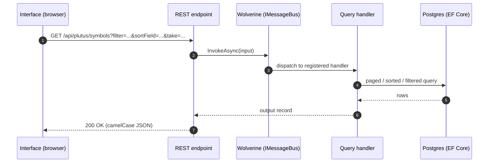
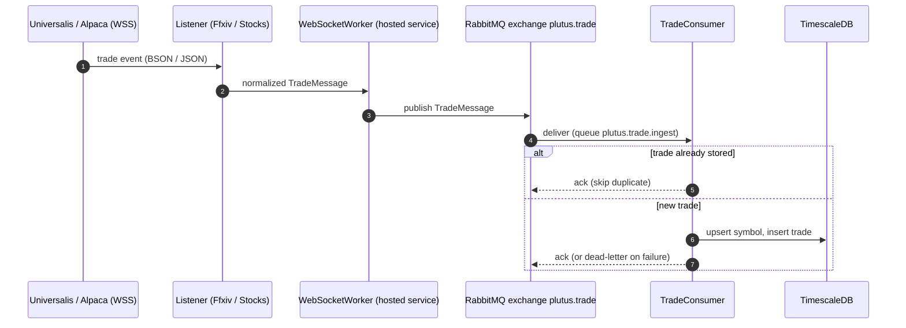
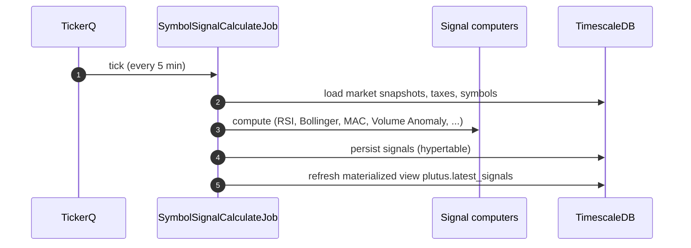
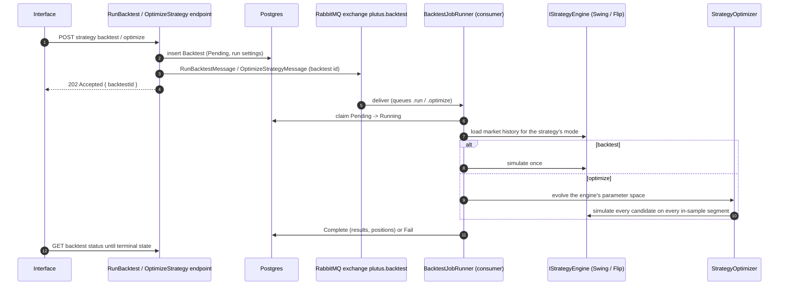
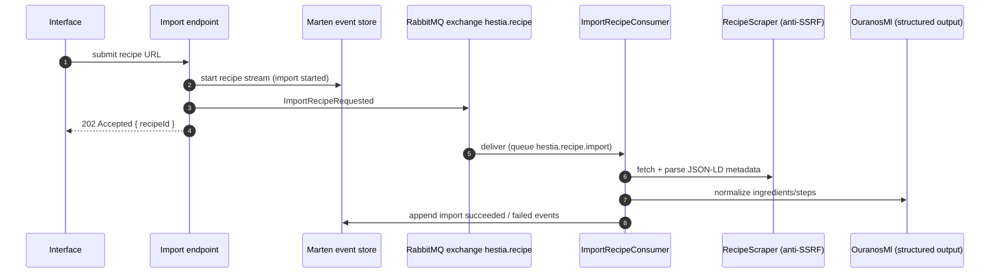
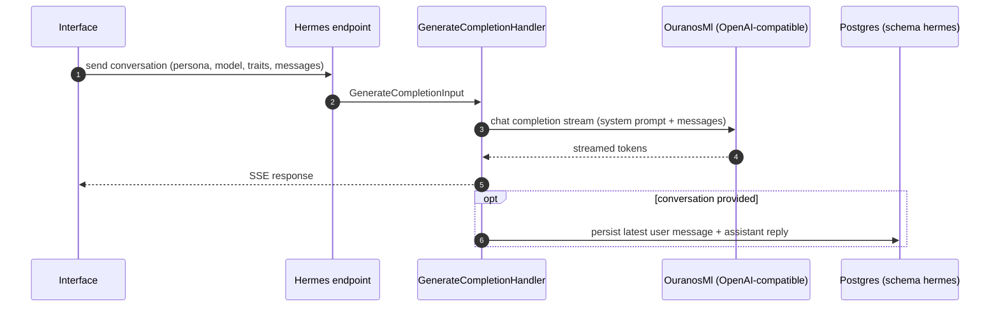
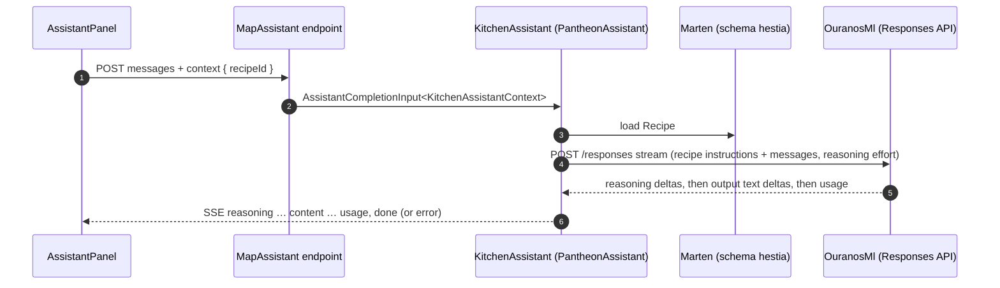

# 6. Runtime View

This section traces the system's key scenarios. All of them are driven by the building
blocks of [Section 5](05-building-block-view.md) and the conventions of
[Section 8](08-crosscutting-concepts.md).

## 6.1 Scheduled Jobs Overview

Recurring work is coordinated by TickerQ jobs (all in-process, with an EF Core-backed
store, dashboard at `/tickerq/dashboard`). Names are the TickerQ function names shown in
the dashboard:

| Job | Module | Schedule | Purpose |
|-----|--------|----------|---------|
| `OsrsDataLoaderJob` | Plutus | every 5 min | Poll OSRS Wiki prices → publish `TradeMessage`s |
| `SymbolSignalCalculate` | Plutus | every 5 min | Recompute signals for all symbols and refresh `plutus.latest_signals` |
| `ForecastGenerator` | Plutus | daily | Generate price forecasts via OuranosMl |
| `SyncModelsJob` | Hermes | hourly | Sync available LLM models from OuranosMl |
| `NotificationSender` | Shared | every minute | Dispatch pending notifications |

## 6.2 Scenario: Plain Query Request

*The bread-and-butter flow every list endpoint follows.*

Paging, sorting, and the `field:op:value` filter language follow the common query contract
from [Section 8.2](08-crosscutting-concepts.md#82-application-patterns); error handling is
described in [Section 8.6](08-crosscutting-concepts.md#86-errors-and-validation).

## 6.3 Scenario: Real-Time Trade Ingestion

*The continuous pipeline that turns external market events into queryable aggregates.*

Trades missed while a WebSocket is disconnected are not replayed. The OSRS variant replaces
steps 1–2 with `OsrsDataLoaderJob` polling on a 5-minute schedule; it retries when the
Wiki has not published a new bucket yet and records the last processed bucket in
`OsrsDataLoaderState`. Continuous aggregates keep market views query-ready without
query-time aggregation.

## 6.4 Scenario: Signal Calculation and Forecasting

*Every five minutes, computed signals refresh the analytical surface.*

The daily `ForecastGenerator` job calls OuranosMl (`POST /plutus/forecast`) in batches for
markets with forecasting enabled and persists a `ForecastRun` with its `Forecast` and
`ForecastRecord` rows. No job evaluates forecasts: efficacy is computed on request by
joining forecast records to realized daily prices.

## 6.5 Scenario: Backtest / Optimization Run

*An HTTP-triggered, long-running computation executed asynchronously.*

The 202-Accepted-then-poll contract is what the Interface relies on. Everything about a run
is generic except the engine, which the runner picks from the strategy's configuration mode:

- **Run settings** (participation, slippage, and for optimizations the generations,
  population, drawdown weight, out-of-sample ratio and trade target) are stored on the
  backtest, so messages carry only its id.
- **Progress and cancel**: simulators only report a completed fraction and check a
  cancellation token. A `RunMonitor` persists the latest progress every couple of seconds
  and cancels the token when it sees the backtest marked `Cancelled`.
- **Cancel** only sets the status to `Cancelled`; no message is published. The runner never
  overwrites a run that is no longer `Running`.
- **Restart** resets a `Failed` or `Cancelled` backtest to `Pending` in place (same id) and
  republishes the message for its kind, so an optimization restarts as an optimization with
  its original settings.
- **Startup recovery** marks backtests left `Running` by a previous process as `Failed`.

Both simulators share a conservative execution model, so results describe trades that could
actually have been placed. Inventory is accounted as `Holding`s (each round trip is one
closed position), equity is sampled daily, and every sale is taxed per unit by
`MarketRules` (rate rounded down, waived below the minimum, capped at the maximum).

**Swing** (`SwingSimulator`) steps one UTC day at a time over daily trade aggregates:

- **No lookahead**: day *D*'s scores use signals reconstructed from trades up to the end of
  *D−1* (`SwingSignalReconstructor`, which re-runs the live signal computers); fills happen
  at day *D*'s VWAP. Each input blends its signal 70/30 with the previous six eligible days.
- **Fills need liquidity**: nothing is bought or sold on a day the symbol did not trade.
  Each fill is capped at the participation rate × min(day volume, trailing 14-day median
  daily volume). Buys are also capped at the symbol's buy limit × `LimitWindowsPerDay`
  (`Ouranos:Plutus:BacktestData`, default 2).
- **Sizing**: `PositionSizer` (budget share of cash, liquidity cap, buy limit). A candidate
  whose capped fill is worth less than `MinFillFraction` (default 10%) of its intended budget
  is skipped, and the next-best candidate takes the slot.
- **Price impact**: square-root slippage on the filled volume, capped at 5%.
- **End of run**: volume the cap could not sell is marked at the last day's minimum price.

**Flip** (`FlipSimulator`) models a trader who checks in every few hours over side-aware
5-minute bars. Markets that report each bucket as two unlabelled trades (the average buy-side
and sell-side price, as the OSRS loader stores them) are paired back into bars by
`FlipDataQueryService` for the market's liquid, buy-limited symbols. At each check-in unfilled
buy orders are cancelled, holdings bought since the last check-in are listed, and free order
slots (up to `MaxOpenOrders`) get buy orders for the symbols with the highest expected profit
(`FlipQuoter`). A buy fills in a bucket only when its sell-side price is at or below the bid,
a sell only when the buy-side price is at or above the ask, each capped by the participation
rate and the symbol's buy limit over a rolling four-hour window. Unsold holdings are dumped
after the maximum hold and marked at the sell-side price at the end.

**Optimization** is one flow for every mode. The engine describes its tunable numbers as a
`ParameterSpace` (swing: the strategy's own signed input weights, thresholds and sizing;
flip: quoting and sizing settings, never the trader's check-in cadence, open order limit or minimum
price), and a single `ParameterChromosome` evolves it. A strategy's `lockedParameters`
(parameter keys such as `maxPositions` or `weight.SignalRsi`) pin those parameters to the
configured value by collapsing their range to that single value, so the search tunes only the
rest; the optimized configuration carries the locks forward. The optimize endpoint rejects
unknown keys and strategies with every parameter locked. The last `OutSampleRatio` of the
range is held out. The in-sample range is split into segments of the engine's length (~30
days for swing, 7 for flip), simulated in parallel, and a candidate's fitness blends its mean
and worst segment. Per segment, fitness is the return with any single symbol's profit capped
at 25% of gross profit, minus a drawdown penalty, minus a penalty for falling short of the
trade target scaled to the segment. Swing input scores depend only on the data and the
segment's dates, so they are computed once per segment and shared by every candidate. A
result is validated only when both the in-sample and out-of-sample periods are profitable.

**Recommendations** ask the same engine what its simulator would buy right now with the
budget and nothing held (`SwingSimulator.PlanEntries`, `FlipSimulator.PlanOffers`), so live
picks are ranked and sized exactly as in backtests. Swing recommendations score today's
partial trading against signals reconstructed the same way as in a backtest.

## 6.6 Scenario: Recipe Import

*An end-to-end AI-assisted ingestion flow in Hestia.*

Import failures are appended to the stream as `RecipeImportFailed` events. `ReimportRecipe` reruns the same flow for an existing recipe.

## 6.7 Scenario: Streaming Chat

The server is stateless with respect to chat history: the client sends the whole
conversation on every request, and the handler persists only the newest turn.

### Module assistants

Module assistants (e.g. the Hestia Kitchen Assistant) follow the same stateless pattern
but own their prompt: the client sends only messages and a typed context reference.

The Plutus Symbol Analyst (context `{ symbolId, timeFrame }`) follows the same flow, but
instead of reading the store directly it invokes the module's existing query handlers through
`IMessageBus`, each invocation in its own scope with its own `PlutusDbContext`, so the model
sees exactly the numbers the symbol page shows. The prompt is a deliberately lean headline that
costs only the symbol, market and today's summary (`GetDailySymbolSummary`) queries: the
symbol's facts, tax, whether forecasting is disabled, the time frame the user is viewing, and
today's average, low, high and volume. Everything heavier is loaded only when the model asks
for it through a tool: the latest trade with the after-tax price summary and chart buckets for
any time frame (merged down to `ChartPoints` rows, default 8), every signal with a three-point
weekly trend, the 7-day forecast with its error, up to `MaxPositions` positions (default 10)
with truncated notes, and another symbol's summary. The composed system prompt is cached in memory per symbol and time frame
(`Ouranos:Plutus:SymbolAnalyst:ContextCacheMinutes`, default 5), so follow-up turns send a
byte-identical prompt and the inference server restores its cached prompt state instead of
re-processing the whole context.

The Plutus Market Analyst (context `{ marketId, timeFrame, filter?, sortField?, sortDirection?,
skip?, take? }`) is page-scoped: after loading the market it concurrently invokes the market
overview, volume heatmap and market trades handlers, the last with the Explorer's own filter,
sort and page (capped at `MaxViewRows`), so it sees exactly the rows the user sees. The market
landing page sends no view and gets the Explorer's default order. The composed prompt is cached
per market, time frame and view.

## 6.8 Observability at Runtime

Health is exposed via centrally registered checks (Postgres, RabbitMQ, OuranosMl, WebSocket
connectivity, TickerQ). Structured Serilog logs flow to Loki in production. OpenTelemetry
traces and metrics cover the full request and background-process surface - HTTP,
Wolverine messaging, TickerQ jobs, websocket loaders, database calls, and the .NET
runtime - exported over OTLP to the Grafana stack
([Section 8.14](08-crosscutting-concepts.md#814-observability-opentelemetry),
[ADR 0009](../adr/0009-opentelemetry-observability-via-otlp.md)).
