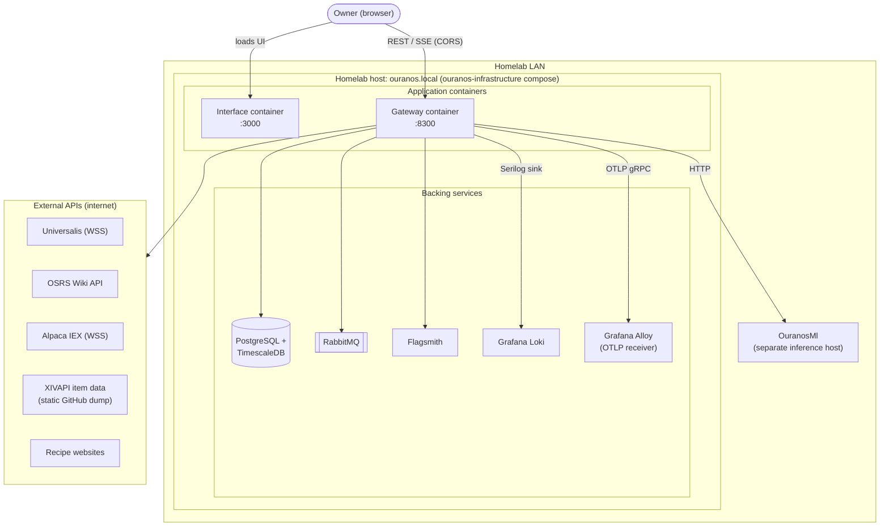
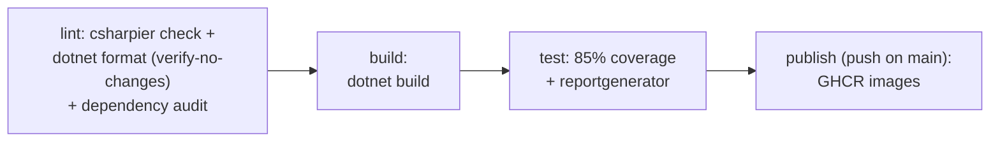

# 7. Deployment View

## 7.1 Deployment Artifacts

Exactly two container images are built and published (`.github/workflows/ci.yml`,
`publish` job: built on every run, pushed from `main` only; [ADR 0011](../adr/0011-container-images-on-ghcr.md)):

| Image | Base | Port | User | Health check | Source |
|-------|------|------|------|--------------|--------|
| `ghcr.io/davwales/ouranos-pantheon/gateway` | `aspnet:10.0` | 8300 | `app` | `GET /health` | `src/apps/gateway/Dockerfile` |
| `ghcr.io/davwales/ouranos-pantheon/interface` | `node:26-alpine` (Next.js standalone) | 3000 | `node` | `GET /` | `src/apps/interface/Dockerfile` |

Each `main` build is tagged `latest` and `sha-<short commit>`; the SHA tag is the rollback target.
Both images are multi-stage and run as a non-root user. The gateway image sets
`ASPNETCORE_HTTP_PORTS=8300` itself. The gateway health check fails while `GET /health` reports
Unhealthy ([Shared module](../../src/modules/shared/docs/README.md)), so an outage of any checked
dependency, including the separate OuranosMl host, marks the container unhealthy. `.dockerignore` keeps local settings
(`appsettings.Development.json`, `.env*`), build logs and non-build folders out of the build
context.

Pushes use buildx with a registry cache (`:cache` tag) and `GITHUB_TOKEN`, so there are no registry
secrets.

## 7.2 Environment Topology

Infrastructure (PostgreSQL/TimescaleDB, RabbitMQ, Flagsmith, Loki, Grafana Alloy) is
provisioned by the separate [`ouranos-infrastructure`](https://github.com/davwales/ouranos-infrastructure)
repository via Docker Compose. This repository assumes those services exist and configures
connections through `appsettings.*.json`; service hostnames (e.g. the Loki sink target
`loki-gateway:3100`) come from that compose project's DNS names. OuranosMl is not part of
that stack: it is a separate system on its own host.

## 7.3 Configuration Surface

| Concern | Mechanism |
|---------|-----------|
| Connections (Postgres, RabbitMQ, OuranosMl, Flagsmith, Loki) | `appsettings.*.json` per environment, overridable by environment variables |
| CORS allow-list | `CorsAllowedHosts` array (policy `AllowLocalAndServer`) |
| Wolverine retry policy | `Ouranos:RabbitMq:RetryCount` (the policy is registered only when it is set): cooldown retries for unexpected exceptions, immediate dead-letter for `ArgumentException`/`InvalidOperationException` |
| Query defaults | `Ouranos:Query` section (`QueryOptions`: paging/sorting limits behind the common query contract) |
| Module settings | `Ouranos:<Module>` section per module (e.g. Plutus data-loader enable flags), documented in each module's README ([Section 5.3](05-building-block-view.md#53-blackboxes-modules)) |
| Feature flags | Flagsmith environments (dev at `ouranos.local:8001`), see [ADR 0012](../adr/0012-feature-flags-via-flagsmith.md) |
| Trace and metric export | `Ouranos:Observability` section (`ObservabilityOptions`): endpoint/protocol/sampling, see [ADR 0009](../adr/0009-opentelemetry-observability-via-otlp.md) |
| Frontend API base | Browser: port 8300 on the host that served the page. Server rendering: `API_BASE` at runtime (default `http://localhost:8300`; in a container, the gateway's network name). `NEXT_PUBLIC_API_BASE` / `NEXT_PUBLIC_API_HOST`, inlined at build time, override both (local development only) |

## 7.4 CI/CD

Each job also runs the matching frontend step (`npm run lint`, `npm run build`, `npm run test`).
The lint job fails on High or Critical advisories in NuGet packages (including transitive ones) and
in the interface's runtime npm dependencies (`npm audit --omit=dev`). Jobs share a NuGet package
cache keyed on the project and central package files. Actions are pinned to commit SHAs, with the
version in a comment for Dependabot. A separate CodeQL workflow (`.github/workflows/codeql.yml`)
scans C#, TypeScript and the workflows on PRs, on `main` and weekly.
Dependabot (`.github/dependabot.yml`) opens grouped update PRs for NuGet (including local
tools), npm, GitHub Actions and Docker base images. They go through the same pipeline.
Majors are not proposed for the Node base image or for packages tied to the .NET runtime
major (EF Core, `Microsoft.Extensions.*`, Npgsql); those move by hand with the next LTS.
Minor and patch updates are set to auto-merge (`.github/workflows/dependabot-auto-merge.yml`)
and land once lint, build and test pass; majors wait for review. Auto-merge is enabled with the
`AUTO_MERGE_TOKEN` Dependabot secret so those merges trigger the publish run like a manual merge.
There is no automated deployment step: promoting a release (pulling new images on the
homelab host) is a manual operation, consistent with the single-operator constraint of
[Section 2](02-architecture-constraints.md).
