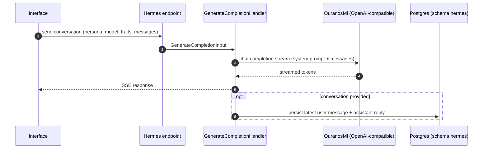

# 6. Runtime View: Hermes

## 6.1 Streaming Chat

The server is stateless with respect to chat history: the client sends the whole
conversation on every request, and the handler persists only the newest turn. Compaction
streams the same way and stores its result as one `Summary`-role message.

The Interface renders Hermes replies through the shared assistant `Message` component, with
`<think>` tags parsed into reasoning blocks.
