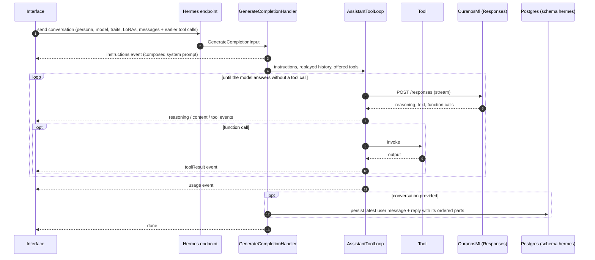
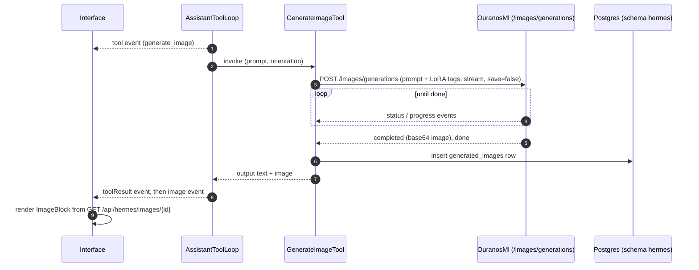

# 6. Runtime View: Hermes

## 6.1 Streaming Chat

The server is stateless with respect to chat history: the client sends the whole
conversation on every request, and the handler persists only the newest turn. A reply that
ends without text is reported as an `error` event and nothing is persisted. Compaction
streams its own `content`/`usage`/`complete` events, ignores the model's reasoning and
stores its result as one `Summary`-role message.

The Interface folds the events into the shared assistant turn UI. Saved replies render from
their parts; older messages without parts fall back to `<think>` tag parsing.

## 6.2 Image Generation

The tool appends one `<lora:identifier:weight>` tag per active LoRA to the prompt it sends
(see [8.5](08-concepts.md#85-image-loras)). The tool streams from OuranosMl so status and progress events keep the connection busy
through a model load and sampling; it uses only the completed image for now. The model sees
only the tool's short output text, never the image. Stopping the reply cancels the request,
OuranosMl interrupts SwarmUI and nothing is stored. While the tool runs, the Interface shows
the tool block with its elapsed time.
