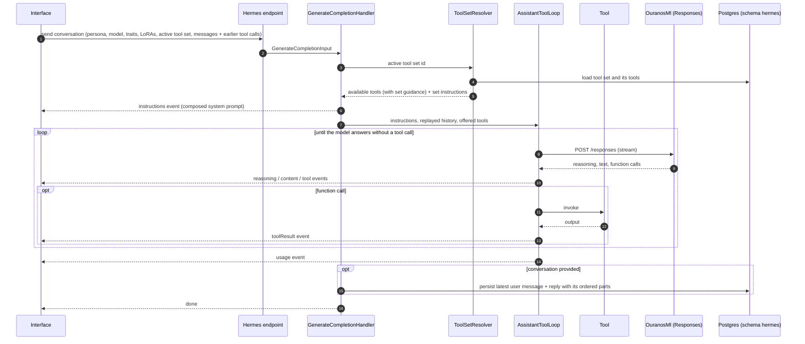
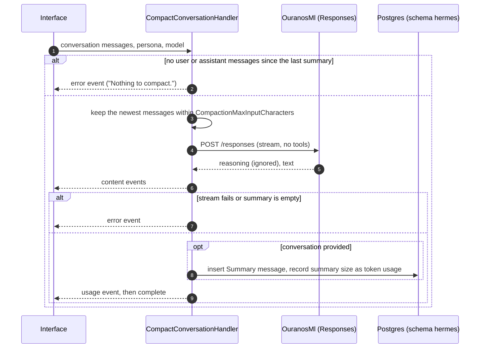
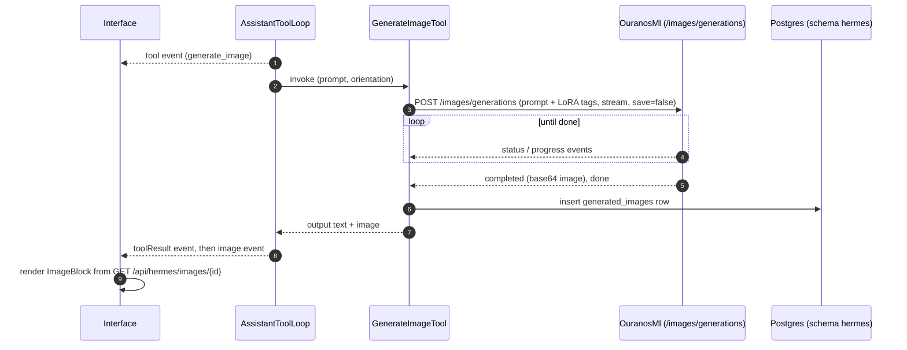
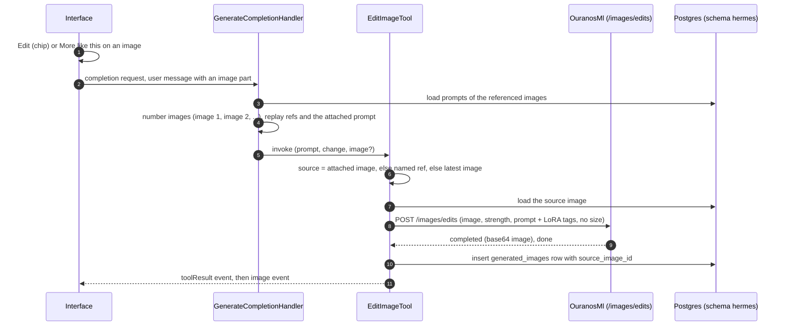

# 6. Runtime View: Hermes

## 6.1 Streaming Chat

The server is stateless with respect to chat history: the client sends the whole
conversation on every request, and the handler persists only the newest turn. A reply that
ends without text is reported as an `error` event and nothing is persisted.

## 6.2 Conversation Compaction

Compaction summarizes the user and assistant messages since the last summary and stores
the result as one `Summary`-role message. The summary prompt is bounded: the newest messages
that fit `CompactionMaxInputCharacters` are kept, older ones are dropped with a note to the
model, and a single newest message that exceeds the budget on its own is truncated. Every
failure (nothing to compact, a stream error, or a summary that comes back empty because
reasoning used up the output budget) ends the stream with an `error` event and saves nothing;
the Interface shows the message and removes the placeholder summary. After a successful
compaction the conversation's token usage is the summary's size, because the summary is the
whole context the next turn starts from.

The Interface folds the events into the shared assistant turn UI. Saved replies render from
their parts; older messages without parts fall back to `<think>` tag parsing.

## 6.3 Image Generation

The tool appends one `<lora:identifier:weight>` tag per active LoRA to the prompt it sends
(see [8.5](08-concepts.md#85-image-loras)). The tool streams from OuranosMl so status and progress events keep the connection busy
through a model load and sampling; it uses only the completed image for now. The model sees
only the tool's short output text, never the image. Stopping the reply cancels the request,
OuranosMl interrupts SwarmUI and nothing is stored. While the tool runs, the Interface shows
the tool block with its elapsed time.

### Image Editing

**Edit** attaches the image to the composer as a removable chip; the user then describes the
change. **More like this** sends "More like this" with the image attached straight away, and
the tool description asks the model to reuse the prompt with `change: subtle`. Without `size`,
OuranosMl keeps the source's aspect ratio, and its random seed makes each variation differ.
The image dialog shows "Edited from" for an edited image (`GET /api/hermes/images/{id}/details`)
and can step back through the sources.
