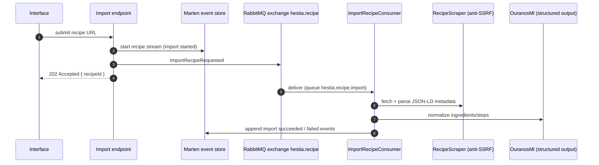
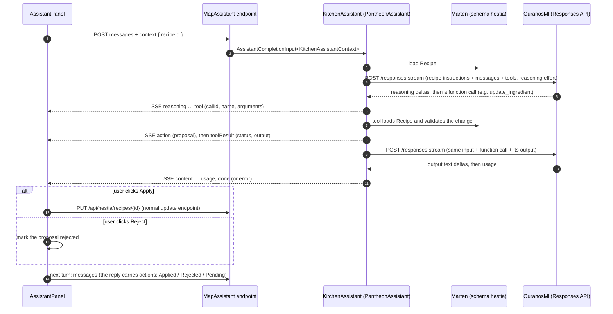

# 6. Runtime View: Hestia

## 6.1 Recipe Import

*An end-to-end AI-assisted ingestion flow.*

Import failures are appended to the stream as `RecipeImportFailed` events. `ReimportRecipe`
reruns the same flow for an existing recipe.

The scraper decompresses responses itself (gzip, deflate, brotli), because the anti-SSRF
handler does not and some sites compress without being asked. Yield, prep/cook/total times and
the image URL are read from the JSON-LD directly into `RecipeDetails`, not by the model.
Reviews, comments, ratings, media and nutrition are stripped before the JSON-LD goes to the
model. Ingredient lines without a unit become `whole` when they have an amount ("3 eggs") and
`as needed` otherwise, unless the model gives a phrase such as `to taste`. A range keeps its
lower bound as the quantity and the original range in the name, as in `eggs (2-3)`.

## 6.2 Kitchen Assistant

The Kitchen Assistant follows the platform's module-assistant flow with context
`{ recipeId }`, loading the recipe from Marten. Its tools only propose changes; applying one
goes through the normal recipe update endpoint.

Because applied changes are ordinary recipe updates, the event-sourced history and revert
remain the undo.
