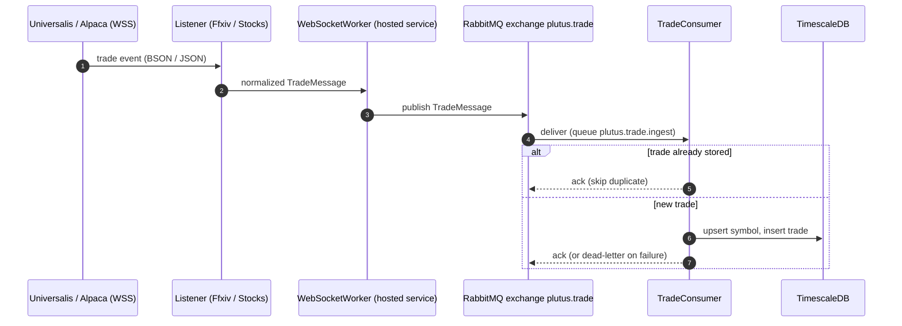
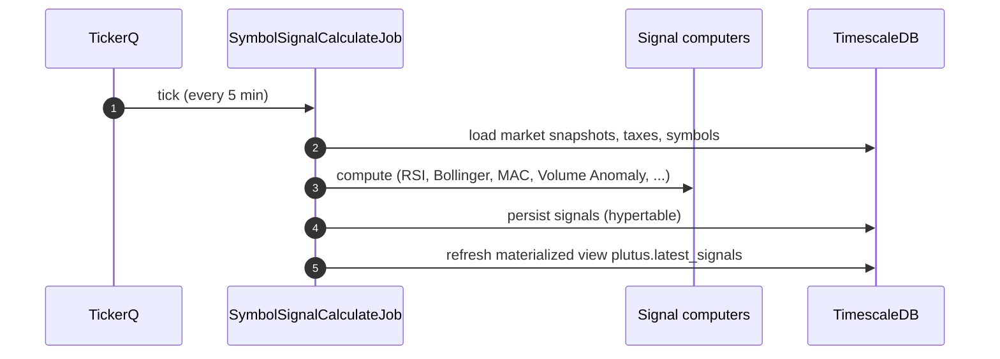

# 6. Runtime View: Plutus

Plutus scenarios built on the platform patterns in
[platform Section 6](../../../../docs/architecture/06-runtime-view.md). The backtest and
optimization scenario is large enough to have its own file:
[Backtest and Optimization](runtime/backtest-optimization.md).

## 6.1 Real-Time Trade Ingestion

*The continuous pipeline that turns external market events into queryable aggregates.*

Trades missed while a WebSocket is disconnected are not replayed. The OSRS variant replaces
steps 1–2 with `OsrsDataLoaderJob` polling on a 5-minute schedule; it retries when the
Wiki has not published a new bucket yet and records the last processed bucket in
`OsrsDataLoaderState`. Continuous aggregates keep market views query-ready without
query-time aggregation.

## 6.2 Signal Calculation and Forecasting

*Every five minutes, computed signals refresh the analytical surface.*

The daily `ForecastGenerator` job calls OuranosMl (`POST /plutus/forecast`, through Plutus's own
`ForecastModelClient`) in batches for
markets with forecasting enabled and persists a `ForecastRun` with its `Forecast` and
`ForecastRecord` rows. No job evaluates forecasts: efficacy is computed on request by
joining forecast records to realized daily prices.

## 6.3 Symbol Analyst

The Symbol Analyst (context `{ marketId, symbolId, timeFrame }`) follows the platform's
module-assistant flow, but instead of reading the store directly it invokes the module's
existing query handlers through `IMessageBus`, each invocation in its own scope with its own
`PlutusDbContext`, so the model sees exactly the numbers the symbol page shows.

The prompt is a deliberately lean headline that costs only the symbol, market and today's
summary (`GetDailySymbolSummary`) queries: the symbol's facts, tax, whether forecasting is
disabled, the time frame the user is viewing, and today's average, low, high and volume.
Everything heavier is loaded only when the model asks for it through a tool:

- the latest trade with the after-tax price summary and chart buckets for any time frame
  (merged down to `AssistantTools:ChartPoints` rows, default 8)
- every signal with a three-point weekly trend
- the 7-day forecast with its error
- up to `AssistantTools:MaxPositions` positions (default 10) with truncated notes
- another symbol's summary, found through the same `find_symbols` and `get_symbol` tools the
  Market Analyst uses

The prompt build rejects a symbol outside the context's market, so tools can trust the
context's market. The composed system prompt is cached in memory per market, symbol and time
frame (`Ouranos:Plutus:SymbolAnalyst:ContextCacheMinutes`, default 5), so follow-up turns
send a byte-identical prompt and the inference server restores its cached prompt state
instead of re-processing the whole context.

## 6.4 Market Analyst

The Market Analyst (context `{ marketId, timeFrame, view? }`) is page-scoped. After loading
the market it invokes the market overview handler and, on the Explorer, the market trades
handler with the Explorer's own filter, sort and page (capped at `MaxViewRows`), so it sees
exactly the rows the user sees. The market landing page sends no view.

Its tools return typed JSON: they screen the whole market with typed conditions (validated
and normalized before they reach the filter syntax), rank symbols by signal score or
forecast gain, look up one symbol by an id those lists return, and summarize the activity
heatmap. On the Explorer, `set_explorer_view` returns the validated conditions as an action,
once per reply, that the page shows as a card and turns into its table filter when the user
applies it. The composed prompt is cached per market, time frame and view.
