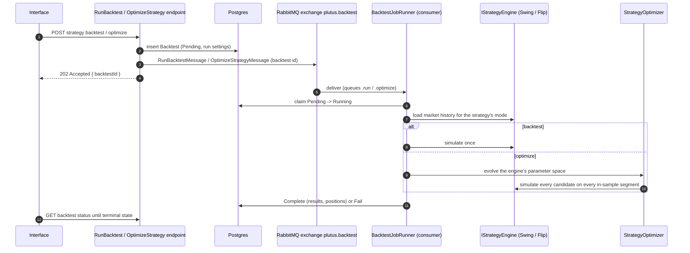

# 6. Runtime View: Backtest and Optimization

*An HTTP-triggered, long-running computation executed asynchronously.* Part of the Plutus
[runtime view](../06-runtime-view.md).

## Lifecycle

The 202-Accepted-then-poll contract is what the Interface relies on. Everything about a run
is generic except the engine, which the runner picks from the strategy's configuration mode:

- **Run settings** (participation, slippage, and for optimizations the generations,
  population, drawdown weight, out-of-sample ratio and trade target) are stored on the
  backtest, so messages carry only its id.
- **Progress and cancel**: simulators only report a completed fraction and check a
  cancellation token. A `RunMonitor` persists the latest progress every couple of seconds
  and cancels the token when it sees the backtest marked `Cancelled`.
- **Cancel** only sets the status to `Cancelled`; no message is published. The runner never
  overwrites a run that is no longer `Running`.
- **Restart** resets a `Failed` or `Cancelled` backtest to `Pending` in place (same id) and
  republishes the message for its kind, so an optimization restarts as an optimization with
  its original settings.
- **Startup recovery** marks backtests left `Running` by a previous process as `Failed`.

## Execution Model

Both simulators share a conservative execution model, so results describe trades that could
actually have been placed. Inventory is accounted as `Holding`s (each round trip is one
closed position), equity is sampled daily, and every sale is taxed per unit by
`MarketRules` (rate rounded down, waived below the minimum, capped at the maximum).

**Swing** (`SwingSimulator`) steps one UTC day at a time over daily trade aggregates:

- **No lookahead**: day *D*'s scores use signals reconstructed from trades up to the end of
  *D−1* (`SwingSignalReconstructor`, which re-runs the live signal computers); fills happen
  at day *D*'s VWAP. Each input blends its signal 70/30 with the previous six eligible days.
- **Fills need liquidity**: nothing is bought or sold on a day the symbol did not trade.
  Each fill is capped at the participation rate × min(day volume, trailing 14-day median
  daily volume). Buys are also capped at the symbol's buy limit × `LimitWindowsPerDay`
  (`Ouranos:Plutus:BacktestData`, default 2).
- **Sizing**: `PositionSizer` (budget share of cash, liquidity cap, buy limit). A candidate
  whose capped fill is worth less than `MinFillFraction` (default 10%) of its intended budget
  is skipped, and the next-best candidate takes the slot.
- **Price impact**: square-root slippage on the filled volume, capped at 5%.
- **End of run**: volume the cap could not sell is marked at the last day's minimum price.

**Flip** (`FlipSimulator`) models a trader who checks in every few hours over side-aware
5-minute bars. Markets that report each bucket as two unlabelled trades (the average buy-side
and sell-side price, as the OSRS loader stores them) are paired back into bars by
`FlipDataQueryService` for the market's liquid, buy-limited symbols. At each check-in unfilled
buy orders are cancelled, holdings bought since the last check-in are listed, and free order
slots (up to `MaxOpenOrders`) get buy orders for the symbols with the highest expected profit
(`FlipQuoter`). A buy fills in a bucket only when its sell-side price is at or below the bid,
a sell only when the buy-side price is at or above the ask, each capped by the participation
rate and the symbol's buy limit over a rolling four-hour window. Unsold holdings are dumped
after the maximum hold and marked at the sell-side price at the end.

## Optimization

Optimization is one flow for every mode. The engine describes its tunable numbers as a
`ParameterSpace` (swing: the strategy's own signed input weights, thresholds and sizing;
flip: quoting and sizing settings, never the trader's check-in cadence, open order limit or
minimum price), and a single `ParameterChromosome` evolves it using the kernel's genetic
algorithm.

A strategy's `lockedParameters` (parameter keys such as `maxPositions` or
`weight.SignalRsi`) pin those parameters to the configured value by collapsing their range to
that single value, so the search tunes only the rest; the optimized configuration carries the
locks forward. The optimize endpoint rejects unknown keys and strategies with every parameter
locked.

The last `OutSampleRatio` of the range is held out. The in-sample range is split into
segments of the engine's length (~30 days for swing, 7 for flip), simulated in parallel, and
a candidate's fitness blends its mean and worst segment. Per segment, fitness is the return
with any single symbol's profit capped at 25% of gross profit, minus a drawdown penalty,
minus a penalty for falling short of the trade target scaled to the segment. Swing input
scores depend only on the data and the segment's dates, so they are computed once per
segment and shared by every candidate. A result is validated only when both the in-sample
and out-of-sample periods are profitable.

## Recommendations

Recommendations ask the same engine what its simulator would buy right now with the budget
and nothing held (`SwingSimulator.PlanEntries`, `FlipSimulator.PlanOffers`), so live picks
are ranked and sized exactly as in backtests. Swing recommendations score today's partial
trading against signals reconstructed the same way as in a backtest. Orders are capped at the
volume participation rate of the strategy's latest completed backtest or optimization (the
default rate when it has none), or at the `volumeParticipationRate` the caller passes, and the
response reports the rate used.
